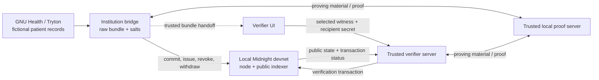

# Chart

Chart is an open-source experiment in checking narrow facts about synthetic health records with GNU Health, Midnight, and zero-knowledge proofs. I want to explore what a recipient needs to learn to make a decision, and what can stay private.

[Quick start](#quick-start) · [Architecture](docs/ARCHITECTURE.md) · [Developer guide](docs/DEVELOPMENT.md) · [Demo walkthrough](docs/DEMO.md) · [Security](SECURITY.md)

> [!WARNING]
> **Research prototype — synthetic data only.** Chart is a local technical demonstration, **not clinical software** or a production consent/identity system. Use fictional records and the local devnet only. Never use real patient data, clinical credentials, or wallets holding public-network funds. See [security boundaries](#what-chart-does-not-guarantee).

## The Inspiration Behind Chart

As technology becomes more integrated into our everyday lives, privacy has become increasingly important. We're constantly sharing personal information with applications, institutions, and services, often without knowing exactly how much of that information is being accessed.

I think healthcare is one of the fields where privacy should be an absolute priority. Medical records contain some of our most sensitive personal information, and patients should have as much control as possible over who can access it and why.

While healthcare systems have made significant progress in protecting patient data, there are still situations where information is shared beyond what's strictly necessary.

For example, imagine a researcher screening patients for a clinical trial. They might only need to confirm whether a patient's blood test result falls within a particular range. Even with existing systems that restrict access to specific records, the researcher may still receive the actual laboratory result when all they really need is a yes-or-no answer.

That got me thinking: **What if we could verify something about a patient's medical information without revealing the information itself?**

This idea first took shape during a hackathon, where I began exploring how zero-knowledge proofs could be applied to healthcare data verification.

The hackathon was the starting point, but I wanted to take the idea further than an initial prototype. I kept working on Chart's GNU Health integration, independent Midnight verification workflow, and scoped, revocable tokens, with a focus on making the project reproducible, testing its failure cases, and documenting its security boundaries.

The current version has **86 automated checks** and an end-to-end verification workflow tested using synthetic healthcare records. That is evidence for the local demonstration, not a claim that it is ready for clinical use.

Chart is still an experimental project, but the goal is simple: **explore how we can verify sensitive medical information while revealing as little of it as possible.**

## From the hackathon prototype to this release

The [first tracked prototype](https://github.com/RagoSpams/Chart/tree/bb73dc4c81f150d412084cf1ddfda5695b843fd3) already contained a GNU Health wizard, bridge, Compact contract, separate verifier, and scoped, expiring, revocable tokens. The comparison below uses that repository history as its baseline.

The changes leading to the validated release are more concrete:

| Area | What changed |
| --- | --- |
| Authorization | Bearer authentication for the local institution bridge, required recipient public keys, and stricter validation before wallet initialization |
| Contract correctness | Previously issued tokens stop working after record withdrawal; missing lab observations cannot pass; inverted lab ranges are rejected |
| Security tests | Coverage for expiration boundaries, revocation, wrong recipients, malformed inputs, unauthorized API access, and withdrawal across claim categories |
| Reproducibility | Compatible shared WASM/runtime pins, a Windows/WSL compiler wrapper, isolated GNU Health setup, and a tested synthetic end-to-end runner |
| Developer experience | Setup scripts, CI configuration, startup checks, and an actual clean-checkout validation process |
| Honest privacy claims | Clear documentation of the trusted verifier/proof server, witness handoff, public metadata, remaining dependency advisory, and unresolved historical timeout |

The architecture began at the hackathon. This release makes that implementation easier to run, examine, and improve. The [release inventory](RELEASE_PREPARATION.md) and [validation report](VALIDATION_REPORT.md) record the changes and the checks behind the current claims.

## What Chart demonstrates

An institution records a salted commitment to a **synthetic** health-record bundle and issues a verification token scoped to a particular recipient, claim type, and expiration time. The recipient uses a trusted local verifier service to generate a proof and submit a transaction; the Midnight node checks it against the committed data and token rules.

| Capability | Demonstrated behavior |
| --- | --- |
| **Narrow claims** | Vaccination, laboratory-range, and critical-flag predicates |
| **Recipient binding** | A token is intended for a specific verifier public key |
| **Limited permissions** | Tokens authorize only selected claim categories |
| **Expiry & revocation** | An expired or revoked token cannot authorize verification |
| **Record withdrawal** | Withdrawing the underlying record invalidates previously issued tokens |
| **Independent checking** | A separate verifier process reads shared ledger state and submits verification transactions |
| **Actual integration** | GNU Health/Tryton → authenticated bridge → local Midnight contract → verifier, with synthetic data |

### A simple example

**Private input (synthetic data):** a recorded lab measurement and its allowed range.

**Question:** does the committed measurement satisfy the authorized range predicate?

**Verifier result:** a proof-backed true/false outcome. The value is not a public ledger input, but the current handoff gives it to the trusted verifier server, and the proof server receives proving material. This demo does not keep the measurement secret from a recipient who operates that verifier.

The current lab circuit compares the observation with the range committed by the institution; it is not a complete clinical-trial eligibility engine.

The exact information revealed depends on the circuit and public inputs. For example, the vaccination proof also exposes scheduling fields; repeated queries may reveal information over time. Chart does **not** promise that the verifier learns *only* one bit in every workflow.

## How Chart works



1. **Prepare a synthetic record.** The GNU Health integration supplies structured health information through a Tryton wizard, or the bridge creates synthetic demo data.
2. **Commit the bundle.** The bridge supplies private inputs to the contract circuit through the local proof service; the ledger stores commitments and disclosed record metadata.
3. **Issue a scoped token.** The institution selects a verifier public key, claim categories, and expiration.
4. **Generate and validate a proof.** The trusted verifier server uses the selected witness and recipient secret with the local proof server, submits a verification transaction, and waits for node finalization and indexer observation. An authorized claim can return true or false; that differs from an authorization rejection.
5. **Enforce changes.** Revocation, expiry, recipient mismatch, and record withdrawal are explicitly checked.

For the exact flow, responsibilities, and exposed metadata, see [Architecture & trust boundaries](docs/ARCHITECTURE.md).

## Quick start

**Prerequisites:** Node.js **22.12+** (24 tested), npm, Python **3.12** for tests and the optional GNU Health integration, Docker Desktop or Docker Compose, and the **pinned Midnight Compact toolchain**. On Windows, install Compact in **Ubuntu WSL**, not through Windows' unrelated `compact.exe` command.

Install Compact CLI **0.5.1** and compiler **0.31.1** in Linux/macOS/Ubuntu WSL (see the [official installation guide](https://docs.midnight.network/getting-started/installation) before running the installer):

```sh
curl --proto '=https' --tlsv1.2 -LsSf https://github.com/midnightntwrk/compact/releases/download/compact-v0.5.1/compact-installer.sh -o /tmp/compact-installer.sh
sh /tmp/compact-installer.sh
export PATH="$HOME/.local/bin:$PATH"
compact update 0.31.1
compact compile +0.31.1 --version
```

Make sure `python` resolves to Python 3.12; the [developer guide](docs/DEVELOPMENT.md#python-command) covers POSIX shells without that alias. From the repo root, run:

```sh
npm ci --ignore-scripts
npm test
```

`npm test` runs Node/API/browser-input tests, Python encoding tests, Compact compilation and circuit tests, TypeScript checks, and all workspace builds. **It does not start the real devnet or run the persisted GNU Health fixture.**

For an actual local Midnight proof/transaction workflow, start Docker and run:

```sh
npm run devnet:up
npm run test:e2e
```

To include a persisted synthetic patient in **real GNU Health/Tryton**, or to launch the local browser UI, follow the tested commands in the [Developer guide](docs/DEVELOPMENT.md). The end-to-end runner uses fresh synthetic state, explicit authorization failure checks, and a bounded timeout; it is not a mocked proof-success path.

## Explore the browser demo

Generate credentials in your local checkout:

```sh
node scripts/create-local-env.mjs
```

Start these in **three separate terminals**:

```sh
node --env-file=.env --import tsx bridge/src/index.ts
node --env-file=.env --import tsx verifier/server/src/index.ts
npm run dev:verifier-web
```

Open [the local verifier UI](http://127.0.0.1:5174). The bridge listens on `127.0.0.1:4000` and verifier API on `127.0.0.1:4200`. The interface derives a verifier public key but displays a shortened version. There is no institution-facing UI: the [demo walkthrough](docs/DEMO.md#prepare-a-browser-handoff) supplies a concrete authenticated API handoff, including a full public key and matching demo identity. **Do not paste the bridge API key into the browser.** For the step-by-step flow, see [Demo walkthrough](docs/DEMO.md).

## Repository map

| Path | Responsibility |
| --- | --- |
| `contracts/` | Compact circuits, contract state, and contract tests |
| `bridge/` | Institution-side HTTP API, Midnight integration, commitments and token issuance |
| `verifier/server/` | Local verifier service, recipient/proof checks and chain reads |
| `verifier/web/` | React/Vite verification UI |
| `tryton_modules/` | GNU Health/Tryton wizard and Python integration tests |
| `scripts/` | Local credentials, reproducible setup, diagnostics, release checks and E2E runner |
| `docs/` | Architecture, developer commands, demo, and design rationale |

## Validation

The first public-release candidate was locally validated with **86 passing automated checks** (18 Node, 60 Compact, 4 Python encoding, and 4 real Tryton tests), all workspace builds, and clean-checkout integration runs through real local proof generation and finalized transactions. The separate real GNU Health test and full devnet workflow were run as described in [VALIDATION_REPORT.md](VALIDATION_REPORT.md). The committed GitHub Actions workflow is configured to run the build/test subset, **not** the complete Docker-based GNU Health integration; the reports record local evidence, not a promise that every remote CI run is green.

The earlier [AUDIT_REPORT.md](AUDIT_REPORT.md) is preserved for context; the validation report supersedes its original testing status.

Validation is evidence of reproducibility within the documented local environment, not a clinical or cryptographic security audit. [Read the complete validation evidence](VALIDATION_REPORT.md).

## What Chart does not guarantee

- **Clinical truth:** a proof validates a predicate about *committed data*; it does not prove that the original measurement was medically accurate, recent, correctly measured, or legitimately sourced.
- **End-to-end zero disclosure:** the trusted local verifier server receives the selected witness bundle and recipient secret, and the local proof server receives proving material; the institution bridge handles raw bundles and salts. No real patient records belong in this demo.
- **No metadata leakage:** the ledger exposes identifiers, commitments, scopes, public recipient keys and transaction metadata; vaccination verification additionally reveals scheduling fields.
- **Real-world consent, legal compliance or identity:** there is no production patient-consent, institutional identity, multi-tenancy, or clinical approval model.
- **Production availability or a clean dependency audit:** local finalization has historically timed out once without an established root cause. The locked Midnight dependency tree retains **12 moderate runtime entries from one upstream cookie advisory**, with no reachable vulnerable use found in the current demo. Details: [DEPENDENCY_AUDIT.md](DEPENDENCY_AUDIT.md) and [VALIDATION_REPORT.md](VALIDATION_REPORT.md).

**Why a blockchain?** The shared ledger can provide a common view of commitment/token status and withdrawal across independent parties. A centralized signed-assertion or off-chain ZK approach may be simpler for other use cases. Chart demonstrates one set of trade-offs; it does not argue that blockchain is necessary for every medical verification task. [Read the design rationale](docs/ARCHITECTURE.md#why-midnight-and-why-not-always).

## Contributing

This is an experimental open-source project meant to be explored and extended. Contributions to negative tests, accessibility, interoperable record mapping, safer local proofs, developer experience, and benchmarks are welcome. Start with [CONTRIBUTING.md](CONTRIBUTING.md) and [SECURITY.md](SECURITY.md). **Please use synthetic records only.**

## License

The original TypeScript and Compact code is licensed under [MIT](LICENSE). The Tryton module is **GPL-3.0-or-later**, with its own [license terms](tryton_modules/health_midnight_disclosure/COPYING). Third-party dependencies retain their respective licenses.
