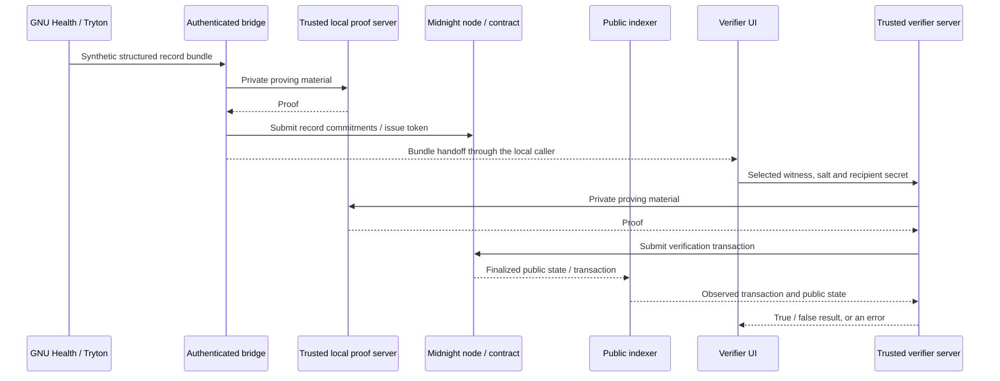

# Architecture and trust model

[← Project overview](../README.md) · [Run the demo](DEMO.md) · [Development](DEVELOPMENT.md)

## Design goal

Chart shows how a third party can verify an **authorized, narrow predicate** over a committed *synthetic* medical record without needing the underlying value as a public contract input. It is not a general EHR replacement, consent engine, clinical validation service, or full zero-disclosure architecture.

## Components

The exact demonstration flows vary by entry point: the Tryton wizard supplies actual persisted synthetic ORM values; the bridge HTTP route can also generate synthetic defaults. The verifier is a separate process, **not a trustless remote website**.

| Boundary | What it knows | What it must be trusted to do |
| --- | --- | --- |
| GNU Health/Tryton | Source synthetic patient, vaccination and lab fields | Supply correct inputs for the demonstration; production provenance is not established |
| Bridge | Raw synthetic bundle, salts, institution API key, wallet/private state | Validate fields, commit the intended bundle, issue/revoke tokens only for authorized clients |
| Midnight ledger | Commitment and record/token identifiers, token scopes, recipient public keys, metadata | Enforce contract predicates, expiration/revocation, withdrawal and recipient binding under the demo's cryptographic assumptions |
| Verifier server | Full selected witness bundle and recipient secret | Protect inputs, request a proof, submit the transaction and wait for finalization/indexer observation |
| Proof server | Private proving material from bridge/verifier requests | Generate proofs without exposing or retaining sensitive inputs; keep verbose preimage logging disabled |
| Browser UI | Local demo identity in browser storage, user-entered bundle/token data | Is not a secure identity wallet; do not use with real patients |

## Claim types

- **Vaccination:** proof logic over committed vaccination facts; the currently public output also exposes `hasNextDose` and `nextDoseDate`.
- **Lab range:** checks `analysisDate > 0` and whether the committed result lies inclusively between the committed `rangeLow` and `rangeHigh`. The verifier cannot choose arbitrary new bounds at query time. The fixture uses an x10-scaled decimal and a tested synthetic observation; units and clinical reference validity are not independently attested.
- **Critical flag:** returns one of nine committed boolean flags selected by `requestedFlag` (0–8). A token grants the critical-flags category; it does not restrict access to just one individual flag.

The exact contract public inputs, proof statements and leakage properties must be reevaluated whenever circuits change.

## Authorization lifecycle

1. Commit a record bundle (with salts) to the contract.
2. Issue a token bound to a verifier public key and allowed categories, with an expiry time.
3. Verify only where the token, recipient, record and requested scope are valid.
4. Reject expired/revoked tokens and tokens tied to withdrawn records.

Expiration, revocation and withdrawal are forward-looking authorization checks; they cannot erase results that a verifier has already learned. Avoid treating revocation as deletion of the original medical information.

## Why Midnight and why not always?

In this integration the ledger provides shared, independently readable state for commitment existence and token status, while Compact circuits express restricted proofs. This is an illustrative architectural choice, not a conclusion that a blockchain is required. For a single trusted issuer/verifier relationship, a signed credential, off-chain ZK proof or existing FHIR access control may be simpler, cheaper and more appropriate.

Chart complements selective sharing; it does not replace clinical FHIR semantics, patient consent, source signatures or regulated health-data exchange.

## Security boundaries and residual risks

- Services default to loopback. The bridge bearer key is **single-institution local authorization**; CORS isn't authentication or a tenant boundary.
- The verifier server receives **the selected witness and recipient secret**, and the proof server receives private proving material. The lab value is not hidden from a recipient who operates that verifier. Never use untrusted services.
- The bridge returns all three synthetic category bundles and salts to the authenticated submitter. On-chain token scope does not encrypt or revoke access to a raw bundle already shared; optional raw bundle export is disabled unless `CHART_ALLOW_RAW_BUNDLE_EXPORT=true`.
- No production patient identity, consent policy, provenance attestation, medical timestamp freshness requirement, units guarantee or audit-log regime is implemented.
- Repeated yes/no questions can themselves narrow the possible private value. The ledger also exposes transaction metadata.
- The local test genesis wallet seed is public test material only; never use it for public network funds.
- A single historically observed finalization stall remains without a proven root cause. Diagnostics and bounded integration timeouts are in place; never blindly resubmit after an unknown on-chain outcome.
- The pinned runtime retains one upstream moderate cookie advisory across twelve npm packages. Its affected API was not found reachable through Chart's current usage, but the installed code remains unpatched.

## Public results and errors

A valid authorized proof can return `true` or `false`; `false` is a predicate outcome, not an authorization error. The independent verifier maps token expiration/revocation, record withdrawal and recipient mismatch to specific HTTP 403 codes. Malformed inputs are rejected before SDK initialization. Some other contract failures, including an ungranted category, currently surface as a generic HTTP 500. A 500 is not proof success and does not by itself establish an authorization rejection.

Read [SECURITY.md](../SECURITY.md), [DEPENDENCY_AUDIT.md](../DEPENDENCY_AUDIT.md) and [VALIDATION_REPORT.md](../VALIDATION_REPORT.md) before deploying or changing core logic.
